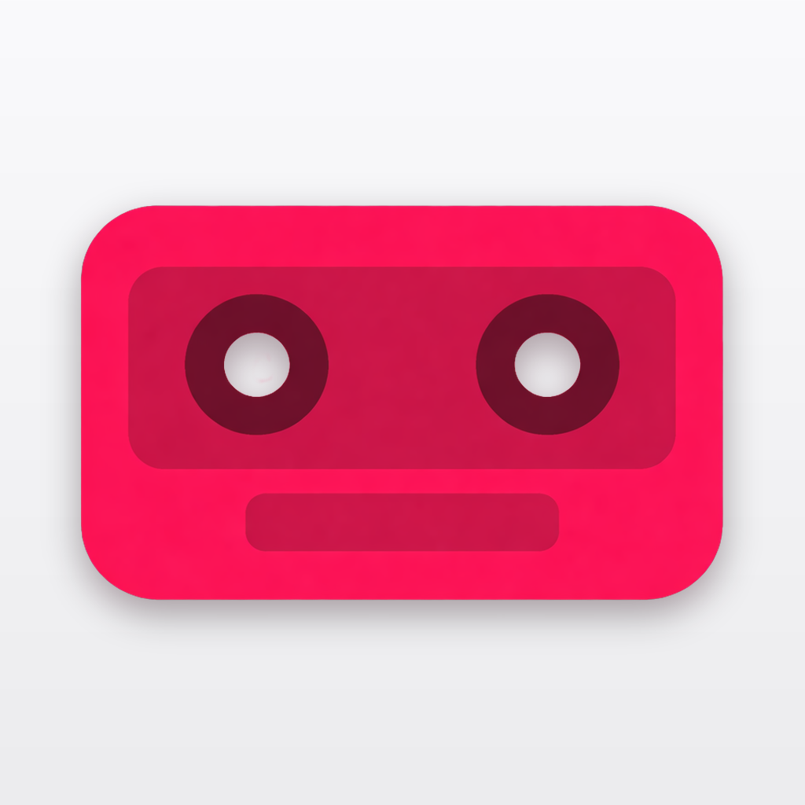
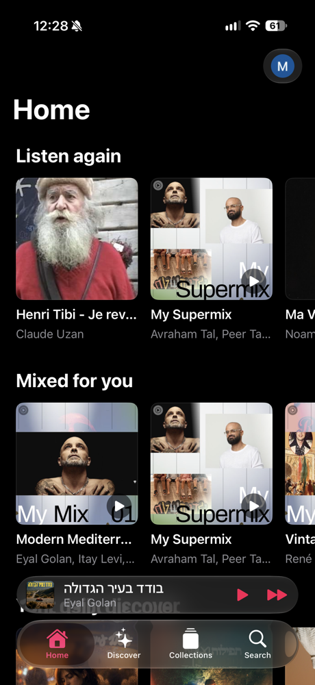
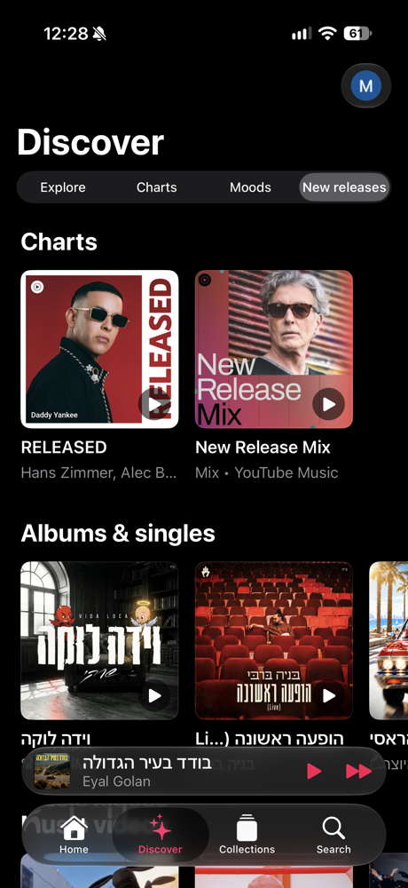
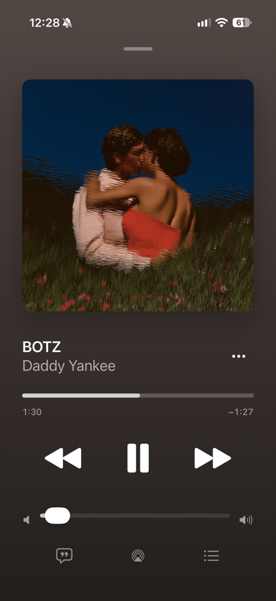

<p align="center">
  
</p>

<h1 align="center">Kaset for iOS</h1>

<p align="center">
  A native SwiftUI YouTube Music client for iPhone, built to keep playing with the screen locked.
</p>

---

Kaset for iOS is an unofficial, open-source YouTube Music client. The interface is fully native
(SwiftUI, Liquid Glass, iOS 26), while playback is delegated to the real YouTube Music web
player running in a hidden web view. That gives you background playback, lock-screen and
AirPods controls, and an Apple Music-like interface, with your own YouTube Music account.

It is **inspired by, and adapted from, [Kaset for macOS](https://github.com/sozercan/kaset)**
by [@sozercan](https://github.com/sozercan): the InnerTube client, response parsers, models,
playback-bridge scripts and the app icon come from there. This project exists because the
macOS app's player stack could not be shared with iOS as is, so the pieces that matter were
carried over and the player was rebuilt for iOS.

> **Disclaimer** – Not affiliated with, endorsed by, or sponsored by YouTube or Google. It uses
> undocumented endpoints that can change at any time. Use it with your own account and at your
> own risk.

## Screenshots

<table>
  <tr>
    <td align="center"></td>
    <td align="center"></td>
    <td align="center"></td>
  </tr>
  <tr>
    <td align="center"><sub><b>Home</b><br>Shelves, tab bar and mini player</sub></td>
    <td align="center"><sub><b>Discover</b><br>Explore, Charts, Moods, New releases</sub></td>
    <td align="center"><sub><b>Now Playing</b><br>Artwork-tinted, Apple Music layout</sub></td>
  </tr>
</table>

## Features

- **Home, Discover, Collections, Search** tabs in the Apple Music layout, with the mini player as the
  tab bar accessory (full pill, compact inline when the bar minimizes).
- **Discover:** Explore, Charts, Moods & genres, New releases.
- **Collections:** Library (playlists, albums, artists), Liked music, History.
- **Detail pages** for playlists, albums and artists (top songs, discography, related artists, follow, radio, shuffle).
- **Now Playing** modelled on Apple Music: artwork-tinted background, scrubber, system volume,
  like, lyrics, AirPlay, queue (jump to / remove), shuffle and repeat.
- **Background playback:** keeps going locked, advances through the queue, lock-screen / Control
  Center / AirPods next-previous, native Now Playing card.
- **Recovery:** web content termination, stuck streams and network changes bring playback back
  to the same track and position; the last session is restored after a cold start.
- **Account:** Google sign-in, brand-account switching, avatar in the navigation bar.
- **Settings:** audio quality, content language, haptics, optional ad skipping (off by default).
- **Localized** in English and French.

## How it works

```
 SwiftUI screens ──commands──▶ WebPlayer ──JS──▶ music.youtube.com (hidden web view)
        ▲                          │                         │
        └────── PlaybackState ◀────┴──── page events ◀───────┘
```

- The **web view is the single source of truth** for playback and the queue. The native UI never
  keeps its own player state: taps send commands to the page, and what is drawn is the
  `PlaybackState` mirrored from the page's events and heartbeat.
- **Everything else goes through the InnerTube API** (Home, Search, browse pages, library, ratings),
  authenticated like the web client: Google cookies archived in the Keychain and `SAPISIDHASH`
  request signing.

```
Sources/
  App/        entry point, environment, preferences, localization, assets
  Auth/       cookie archive (Keychain), login, SAPISIDHASH, account switching
  Core/       InnerTube client, models, parsers (adapted from Kaset macOS)
  Playback/   WebPlayer, page scripts, state, Now Playing, audio session
  Features/   Home, Discover, Collections, Search, Detail, Now Playing, Settings, Shell
  Debug/      log and diagnostic screens
Tests/        parsers (sanitized fixtures), auth, playback state
docs/         plan, tracker, spike findings
```

See [`docs/PLAN.md`](docs/PLAN.md), [`docs/TRACKER.md`](docs/TRACKER.md) and
[`docs/spike-findings.md`](docs/spike-findings.md) for the design decisions and the evidence
behind the playback approach.

## Requirements

- Xcode 26 and an iOS 26 device (iPhone first)
- [XcodeGen](https://github.com/yonaskolb/XcodeGen) (`brew install xcodegen`)
- A YouTube Music account (Premium is not required)

## Build and run

```bash
git clone https://github.com/emoonadev/Kaset-iOS.git
cd Kaset-iOS
xcodegen generate
open KasetiOS.xcodeproj
```

Select your team under **Signing & Capabilities**, choose your iPhone, and run.

### Sideloading with a free Apple ID

The app is meant to be sideloaded, not distributed through the App Store:

- A **free Apple ID** works, but the provisioning profile expires after **7 days** and you can
  have a limited number of apps and App IDs; re-run from Xcode to renew it.
- A paid developer account lifts these limits (profiles last a year).
- Change the bundle identifier (`dev.emoona.kaset` in `project.yml`) to one you own.
- Background audio uses the standard `audio` background mode; no special entitlement is needed.
- CarPlay needs an entitlement that sideloaded builds cannot have, so it is not supported.

### Tests

```bash
xcodebuild test \
  -project KasetiOS.xcodeproj -scheme KasetiOS \
  -destination 'platform=iOS Simulator,name=iPhone 17'
```

Parser tests run against sanitized fixtures. Never commit cookies, tokens or captured
personal responses; fixtures use placeholders only.

## Known limitations

- Playback depends on selectors and behaviour of the YouTube Music web page. Shuffle/repeat
  state, queue jump/remove and "add to queue" are best effort and can break when the page changes.
- Queue reordering is not implemented.
- Podcasts, video mode, scrobbling and AI features of the macOS app are out of scope for v1.
- Ad skipping is opt-in and may go against YouTube's terms of service.

## Contributing

Issues and pull requests are welcome. Before opening one, please read `docs/PLAN.md` for the
ground rules: verify endpoints before writing parsers, keep the web view as the source of truth,
and never log secrets.

## Acknowledgements

- [**Kaset for macOS**](https://github.com/sozercan/kaset) by Sertaç Özercan – the project this
  one is inspired by and adapted from. Thank you.
- [XcodeGen](https://github.com/yonaskolb/XcodeGen).

## License

[MIT](LICENSE). Portions adapted from Kaset for macOS are covered by its MIT license, reproduced
in the same file.
